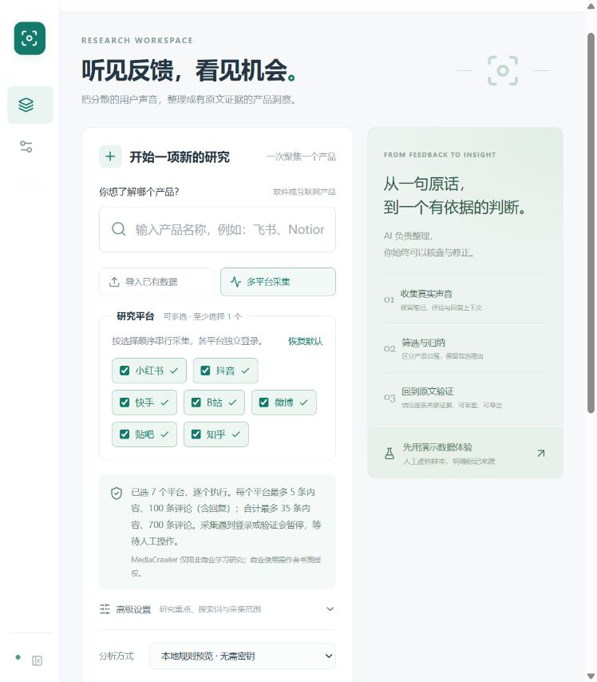
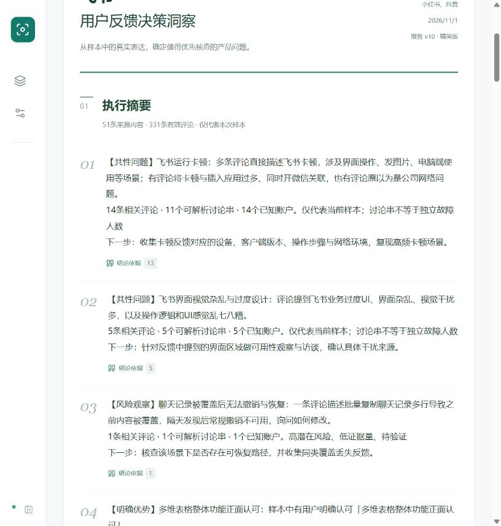

# 观微 · AI 用户反馈洞察工作台

观微帮助产品经理、独立开发者和产品研究人员，从社交平台评论中识别用户关注点、满意体验、具体痛点与功能需求，生成带原文证据的产品洞察报告，辅助确定后续调研和产品优化方向。

**多平台采集 / 数据导入 → 清洗与筛选 → 分阶段 AI 分析 → 人工核查 → 决策洞察 → 报告导出**

本项目为本机运行、单用户使用的中文 Web 应用，适合作为 AI 产品经理的完整实践作品。

## 项目亮点

- **完整研究流程** — 从产品名称生成可编辑搜索词，支持采集、导入、后台分析、人工修正、复用数据重新分析，以及历史任务与报告查看。
- **围绕具体问题理解反馈** — 分别识别评论意图、情感、评价对象、用户任务与具体障碍，建立动态两级产品维度。保留细粒度观点，审核议题成员和正反观点的可比性。
- **结论可追溯、统计可核对** — 结论关联实际评论，保留原文、笔记与父评论上下文。程序计算评论数、观点数、讨论串数与可识别账户数，证据不足的内容进入待复核。
- **面向产品决策的报告** — 包含执行摘要、情感分布、维度关注度、核心痛点、四因素研究核查优先级及建议，支持精简版和完整版。
- **网页与 HTML 导出共享报告组件** — 支持 Markdown、CSV、可下载 HTML、浏览器打印 / 另存为 PDF，并提供报告 JSON。

## 界面预览

任务首页支持平台多选、数据导入与采集预算设置。



洞察报告展示摘要、真实统计、研究优先级与原文证据入口。



## 已实现能力

| 环节 | 主要功能 |
| --- | --- |
| 数据接入 | MediaCrawler 独立适配层，支持小红书、抖音、快手、B站、微博、贴吧、知乎七平台多选串行采集，支持 JSON / JSONL / MediaCrawler Excel 导入 |
| 数据清洗 | 按任务内平台与评论 ID 去重，保留原始数据和独立分析副本，短回复结合父评论与笔记上下文处理 |
| 反馈理解 | 相关性筛选、疑似广告标记、多意图与分维度情感、评价对象、场景、痛点、用户期待与关键词提取 |
| 议题归纳 | 动态两级分类、具体问题聚合、逐成员与共同边界审核、正反观点可比性检查、逐结论证据校验 |
| 人工核查 | 评论搜索和筛选、上下文与原文入口、归类修正、排除与恢复、修正记录、失败项恢复 |
| 任务管理 | 后台执行、状态持久化、分平台进度、登录暂停与恢复、取消、重启后中断任务处理 |
| 报告交付 | 执行摘要、图表、痛点与需求、研究优先级、原文索引、研究局限、精简 / 完整报告及多格式导出 |

采集条件以平台实际能力为准。部分平台排序与回复分页能力不同，当前没有统一日期范围过滤。每次任务分析一个软件或互联网产品。

## 技术架构

- 前端采用 React、TypeScript、Vite，报告网页与打印 HTML 共享 React 组件及图表。
- 后端采用 Python、FastAPI、SQLite，后台任务在单进程内执行，状态和阶段结果持久化。
- 模型通过 OpenAI-compatible Chat Completions API 调用，已验证 DeepSeek。分析分批、分阶段执行，结构化 JSON 经过字段与证据校验。
- 采集通过独立子进程适配 MediaCrawler，转换成应用自己的数据契约，页面读取统一接口。

```text
React 工作台
    ↓ FastAPI
后台任务 → 采集适配层 / 文件导入 → 原始数据与规范化评论
    ↓
相关性与观点提取 → 产品维度与具体议题 → 语义审核与证据校验
    ↓
程序统计 + 人工修正 → 洞察报告 → Markdown / CSV / HTML / JSON
    ↕
SQLite 与本地任务文件
```

架构、数据库、状态机及数据流见 [架构设计](docs/ARCHITECTURE.md)。模型阶段、Prompt 和输出结构见 [AI 分析设计](docs/AI_DESIGN.md)。

## 本地启动

需要 Windows、Python 3.11+、Node.js 20.19+ 与 npm。默认仅绑定 `127.0.0.1`。

在项目根目录执行一次安装。

```powershell
powershell -NoProfile -ExecutionPolicy Bypass -File .\setup.ps1
Copy-Item .env.example .env
.\start.cmd
```

浏览器访问 <http://127.0.0.1:8765>。可先点击“先用演示数据体验”，或导入自己的评论文件。演示任务会明确标记为演示模式。

也可以手动安装并启动。

```powershell
py -3.11 -m venv .venv
.\.venv\Scripts\python.exe -m pip install -r backend\requirements.txt
npm.cmd --prefix frontend install
npm.cmd --prefix frontend run build
.\.venv\Scripts\python.exe -m uvicorn insight.app:app --app-dir backend --host 127.0.0.1 --port 8765
```

开发时另开终端执行 `npm.cmd --prefix frontend run dev`，访问 <http://127.0.0.1:5173>。Vite 将 `/api` 转发给本机后端。共享 HTML 导出需要保留构建生成的报告渲染器和 Node.js 环境。

### 模型配置

在根目录 `.env` 配置模型，保存后重启后端。

```dotenv
OPENAI_BASE_URL=https://api.deepseek.com
OPENAI_MODEL=填写账户实际可用的模型名称
OPENAI_API_KEY=填写你的密钥
DEEPSEEK_THINKING_MODE=disabled
```

兼容服务需支持 `/chat/completions` 和 `response_format: json_object`。密钥仅由后端从环境变量或 `.env` 读取，设置页面仅返回是否配置。AI 分析会将评论与必要上下文发送给所配置的模型服务。

无模型配置时，可选择“本地规则预览”体验完整流程。规则预览与 AI 分析在任务和报告中分别标记。AI 调用失败保留已有数据和失败原因，可修复后重新分析。

### 采集准备

MediaCrawler 需单独安装，源码目录和环境由以下变量配置。

```dotenv
MEDIACRAWLER_PATH=./md
MEDIACRAWLER_PYTHON=
```

可从 [MediaCrawler 上游仓库](https://github.com/NanmiCoder/MediaCrawler) 获取源码，并按上游说明安装依赖。默认读取 `md/.venv/Scripts/python.exe`，也可在 `MEDIACRAWLER_PYTHON` 指定其 Python 环境。上游审计记录与本机版本指纹保存在 `docs/upstream/`。

任务默认每个平台最多 5 条内容、100 条评论，数量可调整。遇到登录失效或验证，用户在采集浏览器中手动处理，再回到工作台恢复。详细平台能力与准备步骤见 [采集、登录和恢复说明](docs/COLLECTION.md)。

### 数据导入

支持 UTF-8 JSON、JSONL 和 MediaCrawler Excel，上传上限 20 MB，每类最多 10,000 条。推荐格式如下。

```json
{
  "platform": "xhs",
  "notes": [{"note_id": "笔记ID", "title": "笔记标题", "desc": "笔记正文"}],
  "comments": [
    {"comment_id": "评论ID", "note_id": "笔记ID", "content": "评论原文", "parent_comment_id": null}
  ]
}
```

多平台文件应为每条记录标注 `platform`，或设置文件默认平台。缺失字段保留为空。无评论 ID 的记录独立保留，去重依据为平台和评论 ID。

[导入模板](samples/import-template.jsonl) 提供字段示例，[演示数据](samples/demo-feishu.json) 为明确标记的虚构内容。`examples/` 保留历史报告、验收和固定评测样本，报告与文档中的样本数量对应各自阶段。示例来源链接已移除查询参数，实际采集数据库保存在本机。

## 验证与效果记录

已有 1,000 条真实评论完成分析与导出验证，来源为小红书、抖音各 500 条，共 51 条来源内容。报告 v10 纳入 331 条反馈，提取 366 条可用观点。同批数据迭代后，未映射观点由 70 条降至 11 条，两组已发现的错误聚合案例已拆分，仍有 29 条观点待复核。

上述数据描述该样本的分析结果。未映射数量变化不能单独证明分类准确率提升。当前人工标注尚未形成金标，人工准确率、Precision、Recall、F1 和节省时间均未知。最新验收及限制见 [语义质量验收](docs/SEMANTIC_QUALITY_ACCEPTANCE.md)。

应用已记录 162 项回归测试通过，覆盖去重、短回复上下文、人工排除、结构化输出恢复、问题拆分、证据引用、统计口径与状态处理。可在安装后执行以下命令。

```powershell
.\.venv\Scripts\python.exe -X utf8 -m pytest tests -q
npm.cmd --prefix frontend run build
```

人工抽样、标注结构与评测方法见 [质量评估方案](docs/EVALUATION.md)。模型审核结果与人工标注指标分别记录。

## 当前边界

- 七平台适配已实现。新增平台的真实登录采集验收仍不完整，具体记录见 [多平台验收](docs/MULTIPLATFORM_ACCEPTANCE.md)。真实导入样本验证与真实采集验收分别记录。
- 少量上下文不足、对象不清和议题边界不确定的观点保留待复核。单条长尾问题仍需人工检查是否应合并。
- P0–P3 表示研究核查顺序，开发优先级需要结合实际业务与研发信息另行评估。
- 当前范围为本机单用户、单产品任务，采集串行执行。重启后遗留任务会标记中断，重新分析复用已保存评论。
- 浏览器可打印 / 另存为 PDF，系统打印与 PDF 排版仍需按使用环境核查。

## 项目结构

```text
backend/          FastAPI、任务、数据接入、分析与导出
frontend/         React 工作台、交互报告与共享打印组件
tests/            应用回归测试
scripts/          验证、评估和报告核对脚本
samples/          导入模板与演示数据
examples/         历史报告、界面与评测样本
docs/             产品需求、架构、Prompt、验收与上游审计
```

本地密钥、运行数据、浏览器登录资料、第三方完整采集环境及视频渲染产物通过 `.gitignore` 排除。

## 来源与许可

MediaCrawler 采用 **NON-COMMERCIAL LEARNING LICENSE 1.1**，采集模块仅限非商业学习研究，商业使用需取得作者书面授权。上游许可全文与审计说明已保留，采集适配层支持替换。导入与分析可独立运行。

Sift 采用 MIT 许可，本项目参考其分阶段分析与来源适配思路，审计源码保留于 `docs/upstream/sift/`。运行时分析实现由本项目提供。

来源、复用范围与依赖许可见 [第三方声明](THIRD_PARTY_NOTICES.md) 和 [上游审计](docs/UPSTREAM_AUDIT.md)。
