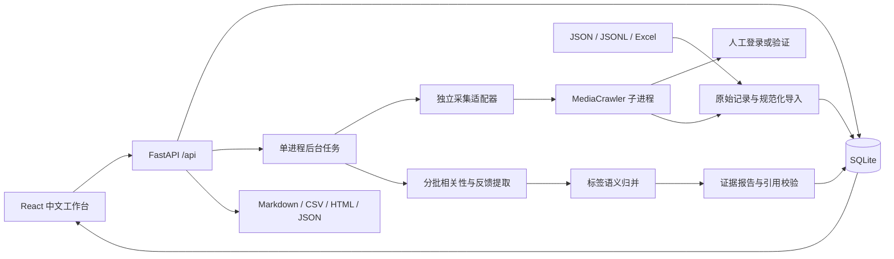

# 架构、数据流与持久化

## 当前V3新增层

当前默认报告为V3决策洞察，[完整数据流及统计契约](DECISION_INSIGHTS_V3.md)。V2细粒度提取继续复用，新增研究派生层，不覆盖原始分析。

`raw_records → comments.analysis → research_cache → effective → report/report_snapshots`。新增SQLite表 `research_cache`，主键为 `task_id + cache_key + input_hash`，保存 `result, created_at`，涵盖逐评论研究初标/规则修正及分类、映射、文案阶段缓存。hash含来源与观点、模型配置，不含密钥。

`decision_state` 按来源hash验证研究标注并派生effective判断，工作台、报告和CSV读取同源数据；来源变化、人工覆盖或父评论排除会使依赖失效。人工审计和原始分析仍各自保留。

V3有效反馈需有目标产品/功能的实质观点；纯资讯、教程/第三方评价不直接纳入。满意/痛点还要求明确实际体验意图，不以情绪代替满意。所有数量、分母、串、账户、附和和优先级由程序计算；精简/完整共享同一报告快照，仅展示深度不同。缺失ID和关系不推测，不跨平台合并身份，不把串或账户当独立故障人数。下文保留通用架构和早期流程。

## 运行结构

浏览器请求立即取得任务 ID，不等待采集或模型完成。`asyncio.create_task` 执行后台任务；模型用异步 httpx，采集子进程 pipe 的阻塞读取在线程中执行。SQLite 使用短事务，每次请求建立连接，WAL 模式。

同一任务不可重复并发执行。采集锁跨任务保证至多一个采集浏览器；多选平台按选择顺序串行，每个平台使用独立子进程与任务子目录。平台普通故障记录后继续后续平台，登录暂停只恢复当前平台，取消停止剩余平台。分析锁避免并发模型调用消耗过多资源。任务和配置独立保存，全局模型设置在执行时快照记录。进程级文件锁防止多后端进程共享同一数据目录；不支持多个 Uvicorn workers，也不允许外部采集程序同时共享上游 profile。

## 数据层边界

1. **原始层**：导入原文件存到 `runtime/tasks/<id>/imports`；每个笔记和评论原始对象追加进 `raw_records`，重复项也保留。采集桥接器额外保留 `_upstream_record`。没有删除或修改原始记录的接口。
2. **规范层**：`notes` 与 `comments.data` 使用应用自己的字段。缺字段为空；按 note/parent ID 补全上下文。分析不直接读取 MediaCrawler 数据类。
3. **判断层**：`comments.analysis` 是自动结果，`overrides` 是人工字段覆盖；重新分析只更新自动结果。`reviews` 记录修正前值、变化和时间。
4. **报告层**：只从相关且未排除、非疑似广告的 effective 记录生成主题和证据。修改任一评论后先保存历史快照，再清除当前 report，防止旧报告继续支持新判断。V2 支持离线重算当前标签，按完整成员保守复用分组，按未变化证据依赖保守复用旧文案；输出明确标注部分完成、没有本轮模型自检。新评论未完成分析时拒绝离线重算。

## SQLite 表

| 表 | 主要字段 | 作用 |
| --- | --- | --- |
| tasks | id, config, status, stage, error, counters, report, version, model_info, source_name, timestamps | 任务配置、状态、报告快照 |
| raw_records | id, task_id, platform, kind, data, collected_at | 追加原始对象，含重复记录 |
| notes | task_id + platform + note_id, data | 跨平台隔离内容上下文与来源关键词 |
| platform_runs | task_id + platform, status, stage, failure_count, error, updated_at | 分平台阶段、失败、恢复；计数从真实数据计算 |
| comments | task_id + evidence_id, platform, comment_id, note_id, data, analysis, overrides | 规范化分析副本 |
| reviews | task_id, evidence_id, before_value, change_value, created_at | 人工修正审计 |
| events | task_id, kind, message, created_at | 真实阶段与恢复记录 |
| settings | key, value | 非敏感模型设置，无密钥 |
| report_snapshots | task_id + version, report, created_at | 报告失效前及完成后保存版本；供离线重算，不直接作为当前报告导出 |

`evidence_id = platform + ':' + comment_id`。父评论同样按平台关联，不跨平台猜测身份。知乎内容 ID 用 `content_type:content_id` 防止不同内容类型重号。缺少评论 ID 使用原始记录本地行号分配内部证据 ID，并标注 missing_id；不是伪造的平台 ID。

旧版本只有小红书。启动时默认旧 config.platforms 为 xhs，原子迁移内容复合主键，补充原始记录平台列；迁移前使用 SQLite backup 保存完整快照到 `runtime/backups/before-multiplatform-*.sqlite3`。已有分析、人工修正和报告不重写，旧报告仍以小红书来源展示。

## 状态机

主流程：`queued → collecting → cleaning → analyzing → reporting → completed / partial`。

采集可进入 `waiting_login`，用户完成人工操作并点击恢复后回到 `collecting`。导入任务先为 `awaiting_data`，导入后为 `ready`，显式开始后进入分析。人工修正后回到 `ready`。

任一步可失败为 `failed`，用户取消为 `cancelled`。采集部分失败而有可用评论时，报告为 `partial`；完全没有评论时失败。存在评论但没有纳入项时生成明确的零样本报告，不生成事实结论。

应用启动把所有遗留 `queued/waiting_login/collecting/cleaning/analyzing/reporting` 改为 `failed`，记录“应用重启导致中断”。已存数据保留，不自动重复采集、不让任务永远显示执行中。正常退出取消后台任务并尝试清理子进程。

分平台状态为 `queued/collecting/waiting_login/completed/partial/empty/failed/cancelled/interrupted`，有别于任务分析状态。应用重启把未完成平台改为 interrupted。每个平台有独立采集预算；报告同时显示全任务和平台分布，不将平台评论数当作产品评分。

## 数据统计口径

- 原始：raw_records 中 kind=comment 的条数。
- 去重：规范化 comments 的条数。
- 重复：原始减去重；无 ID 不去重。
- 有效：effective.relevance=target 且 excluded=false、suspected_ad=false。
- 待确认：uncertain 且未人工排除；待处理：尚无相关性判断。
- 排除：去重总数减有效、待确认与待处理。包括其他产品、无关、疑似广告和人工排除等。
- 主题提及：该主题内唯一证据 ID 数量；比例以有效评论数为分母。一条评论可支持多个主题，所以主题合计可超过有效数和 100%。

CSV 每条规范化评论一行，包含纳入标志、理由、主题与审计记录。报告中的有效数和主题数由程序计算，模型不能自由填写。

## 本机保护与已知边界

服务绑定回环地址，检查 Host 与写请求 Origin，阻止其他网页直接发写请求；这不是面向公网的身份认证系统。不要将服务公开暴露。

密钥仅环境读取；不写入 SQLite、事件、导出或前端响应。模型错误只保留安全的状态/类型，不输出提供商完整响应。外部内容通过 JSON 传入、使用固定系统提示；页面默认由 React 转义，打印 HTML 用 html.escape；CSV 处理公式前缀。以上措施不代表提示注入能被完全消除，人工证据核查仍是报告验收环节。

所有笔记/评论原始内容保存在本机。选择 AI 模式才发送必要上下文到用户配置模型。导入上限 20 MB，Excel 解压数据上限 100 MB，单条文本上限 20000 字，最多 10000 条评论/笔记。规模再增长时需分页数据库查询与更强的任务调度，但第一版无需微服务。

## 语义议题质量层（2026-11-01）

沿用 FastAPI 后台执行、SQLite 和同一个模型客户端。新增 `semantic_quality.py` 负责逐观点含义、动态问题注册、全局同义归并、每条成员独立审核、正反可比性与四因素研究优先级；`semantic_schemas.py` 定义增量契约。`decision_analysis.make_report` 编排调用，程序仍负责数量、分母和证据关系，报告共享组件继续负责网页/HTML/打印。

无需新增数据库表。`research_cache` 的 `comment:<evidence_id>` 派生记录保存 `semantic_revision/semantic_points` 与连续原文依据；阶段缓存按提示、实际载荷、模型提供商哈希隔离。缓存旧结构不符时只重做相应阶段。语义校验失败可逐条保留结构合格项，缺失项不能自动当作合格。

`decision_state.apply_research` 在读取时构造 effective 视图，语义待确认/非产品观点不能进入有效统计。成员复核进一步识别的非产品项也同步派生视图，防止报告、评论页面和CSV使用不同口径。完整人工研究标注优先；原始对象、细粒度分析、人工覆盖和审计记录保留。

报告增量字段位于 `decision.semantic/quality_metrics/executive/evidence_links/resolved_claims`；旧客户端和旧报告字段仍可读取。`evidence_links` 建立评论→观点→议题→顶层及议题内结论索引，反向引用仍是每项的 `evidence_ids`。成员拆分、未映射、生成表述失败与修复原因分别保留，不以提高覆盖率为由强制归类。

`semantic_version=0` 保留历史协议；新 AI 默认1，本地规则仍明确预览。离线重算不会调用模型，仅复用依赖与归属未变的语义映射、可比pair和生成表述；任务状态继续说明本轮没有新的模型复核。
