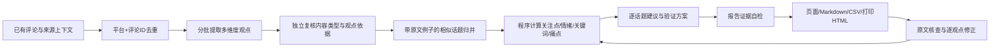

# 产品评论分析 V2：实现与使用

这次采用参考材料中的“细粒度产品维度分析（ABSA）”，在现有应用里完成数据处理、逐条理解、观点聚合、统计与报告。不是只给整条评论一个积极/消极标签。

## 数据流



底层继续 React、FastAPI、SQLite、后台任务和可配置 DeepSeek/OpenAI-compatible 模型；没有新增 PostgreSQL、Redis、Celery 或向量数据库。现阶段用带证据的 LLM 归并即可；将来需要更大规模相似检索时，再实测中文/多语言 embedding。

## 1. 清洗与身份去重

- 按任务内 `platform + comment_id` 合并分析副本，保留原始重复记录和来源词。
- 不同 ID 即使文本完全相同也保留，报告只提示同文组，不能假定同一个用户。
- 语义相似观点归入一个话题，仍统计各自评论。中文短回复和没有产品名的评论不因长度/缺产品词被丢弃。
- 空文本保留原记录，无实质反馈的“蹲/求提醒/纯社交”、公告转贴与疑似广告分别处理，不混为产品使用体验。广告仅为疑似，支持恢复。
- 内容和父评论按平台关联。比较评论按每条观点判定归属，只统计目标产品观点；无法确定时待确认。

## 2. 逐条拆解观点

示意数据，非真实采集结果：“文档编辑很顺手，但手机修改后电脑没有同步，开会前只好手动复制。”

| 关注点 | 观点态度 | 具体反馈 | 痛点 | 明确后果 |
| --- | --- | --- | --- | --- |
| 文档编辑 | 正面 | 编辑顺手 | 未表达 | 未表达 |
| 多端同步 | 负面 | 手机修改后电脑未同步 | 跨端内容未及时更新 | 开会前只好手动复制 |

每条观点保存以下结构；完整 JSON Schema 可从 `/api/schemas` 的 `aspect_extraction_v2` 下载。

```json
{
  "product_scope": "target",
  "aspect": "多端同步",
  "topic": "手机修改后电脑未同步",
  "kind": "problem",
  "sentiment": "negative",
  "basis": "direct",
  "scenario": "开会前",
  "pain_point": "跨端内容未及时更新",
  "impact": "开会前只好手动复制",
  "expected_outcome": null,
  "keywords": ["多端同步", "同步延迟"],
  "quote": "手机修改后电脑没有同步",
  "context_quote": null
}
```

`product_scope` 为目标/其他产品/待确认；情绪允许正面、负面、混合、中性、未知。问题、诉求、提问和体验分开，问“会不会丢数据”不能直接计入已经发生的数据丢失痛点。

“我也是”等附和保留当前原话，并将 `basis` 标为 agreement，另引父评论的连续原文。报告把直接表达和附和数量列开，不让短附和看起来像同等详细的独立故障描述。

## 3. 两层观点校验

第一层检查 Pydantic 字段、评论 ID 完整唯一、当前引用与父引用真实存在；失败仅作一次有界契约修正，仍失败不写入该批结果。

第二层独立核查内容和每条候选观点，使用 `opinion_audit_v2`：

- `content_class=feedback/information_only/non_feedback/uncertain`。纯公告播报不能仅因包含“额度翻倍/月费不变”就被计为用户满意点。
- 对每个候选观点检查支持/不支持/待确认；自嘲、自我纠正、传闻和预测不能升级为产品故障。第三方服务或同公司其他产品不能自动归因目标产品；向博主/平台机器人求提醒不当作明确软件功能诉求。
- 明确场景、后果和诉求必须改为允许来源中的**逐字连续片段**，缺失为空。程序再次校验，无法匹配原文的可空场景/后果/诉求字段置为 null，并在 discarded_fields 保存剔除理由；不会以未知字段阻断整批，也不会把扩写内容当成事实。当前/父评论的核心引用错误仍会触发有界重试和失败。
- `candidate_points` 保存初提取；`points` 保存复核后观点；`opinion_audit` 保存内容类型、逐点理由与剔除数量，便于回查。

两次都是模型判断，不是独立人工金标，不能据此宣称准确率。事实“来自真实原文”也不等于原评论对产品的描述已被证实。

## 4. 聚合与统计

归并输入具体观点、原文例子、情绪和问题。每批最多 24 个候选，最多三轮分层；允许单条话题保留，不强行聚类，不把同一宽泛维度下所有问题合并。人工修正的维度名不会被模型再次改掉。

程序计算：

- 关注点/话题/痛点/关键词：各自覆盖的唯一评论数。
- 覆盖率：该项覆盖评论数 ÷ 最终有效评论数。
- 观点数：独立观点单元数；与评论数不同。
- 正面/负面提及：按对应维度的观点情绪统计，混合表达可同时计入两边。
- 关键词：模型提取短语的评论提及数，**不是原文字面词频**，同一评论多观点重复关键词只计一次。
- 痛点：明确 problem、有痛点描述且有负面/混合体验的观点；提问、担忧、公告与被排除观点不支撑痛点数。
- 需求：明确 request 或有可引用的用户诉求；不把系统猜测命名为“用户潜在需求”。

一评可以多维度、多痛点，因此占比合计可超过 100%。点赞、评论数量不等于独立用户数量。频次只用于排序核查线索，不输出未经业务数据支持的 P0/P1、开发成本或商业优先级。

## 5. 报告和改进建议

页面展示关注点情绪表、关键词及关联原文、具体痛点、用户明确后果和诉求、满意点、需求、核心发现与下一步验证方案。

建议针对最多 12 个有问题/诉求/正面证据的话题生成，不再把每个主题的建议写成固定句子。每个建议和验证方案都引用本话题原文；建议可提出新的解决方向，但需标明待验证，不声称根因已知或改动保证有效。报告自检只检查实际引用及明确父上下文，不从其他评论或常识借事实。建议/验证方案允许提出新办法和新实验，只核查触发前提有依据，不要求尚未做的实验已经得到结论。

所有正式数量由模板读取程序统计；模型自由填写数量/百分比、未知证据 ID 会被拒绝，并有一次有界修正。修正后仍不合格的生成段落会明确省略、记录 omitted_generated_claims，并以“部分完成”报告提示；不会因一句生成文案而丢掉已经校验的统计和原文。模型连接/结构解析失败仍明确失败并保留缓存。长尾话题仍保留统计和证据。原文可以从报告进入抽屉，逐观点修改产品归属、关注点、态度、类型、痛点和引用；改动后旧报告失效。

CSV 增加 `analysis_version/aspects/keywords/pain_points/expressed_impacts/explicit_requests/opinion_points_json/report_topics`，一行仍是一条去重评论；Markdown 和打印 HTML 也包含关注点、关键词、痛点、需求与统计口径。

## 6. 保存、缓存和失败恢复

`comments.analysis` 保存版本化 JSON，不另建一套容易与人工修正失配的数据表；原始对象仍在 `raw_records`。`overrides.points` 保存人工观点，`reviews` 记录修正，重新分析仍优先使用人工结果。

初提取指纹包含评论/父上下文、产品配置、提示词、模型和提供商参数；复核另有版本指纹。先保存已通过引用校验的初提取，再调用复核，网络故障后无需重复初提取。全部复核完成的相同输入可直接复用；模型/上下文变化会失效。排除父评论会清除子评论分析输入中的父文本并重新判断。

后台任务分批写入，刷新后继续看实际阶段。完整报告只在全部校验后发布；任务失败保留原始数据和阶段缓存。仍未对百万评论量进行压测，当前文件导入上限每类 10000 条，采集维持小规模上限。

报告在重新分析、人工修正和追加导入导致失效前保存到 `report_snapshots`，历史内容不再作为当前报告导出。工作台的“仅重算统计（不调用模型）”以最新有效标签重新计算：只复用完整成员不变的旧话题分组；其他观点按原始标签分组。仅当引用评论的全部观点及原文上下文都未变化，才保留对应旧文案。依赖被人工排除父评论的附和自动待确认，不会继续支撑报告。新增评论未完成分析时拒绝离线重算。

离线报告标为“部分完成”，记录 `generation_mode=cached_narrative_recount`、上轮生成时间、依赖过滤方式；没有本轮模型自检。恢复模型后可主动重新分析生成新文案。HTTP 402 不重试，也不会自动切换供应商或继续调用。

观点复核输入显式附带各候选 `point_index` 与 `expected_point_indices`。一次有界修正后仍不匹配的评论隔离为 `needs_review`，不支撑报告，其余可用结果及后续批次继续；报告以部分完成说明待核查数量。再次分析复用已完成结果，只补未通过的复核。说明见 [序号失败修复](AUDIT_PROTOCOL_FIX.md)。

结构错误同样在单条级隔离：仅保留重新通过Pydantic、ID与原文校验的结果，错误路径和类型用于诊断，不记录响应正文或输入值。可空字段缺失为null。归并/建议/核心文案/证据复核结构错误保守退回原始观点分组或省略文案，并在报告说明；网络/鉴权/计费错误仍停止。见 [模型输出恢复](MODEL_OUTPUT_RECOVERY.md)。

旧版报告继续可读；在评论工作台选择“AI 观点分析”并重新分析可升级，不会重新采集。无模型时规则预览只有粗归类，不能当作可靠的细粒度观点、真实痛点或建议分析。

## 7. 评估与验收

测试替身验证工程契约；真实模型结果另行核查，不把两者混称。最新记录见 [V2 验收记录](ASPECT_V2_ACCEPTANCE.md)。

人工评估建议从真实样本分层抽取 100–200 条，覆盖混合情绪、比较产品、短附和、表情/社交、公告、明确痛点、诉求、疑似广告和低频观点。两位标注者分别标产品归属、观点边界/维度/情绪、痛点支持、后果/期待原文，再复核分歧。分别计算相关性、观点维度与情绪、痛点支持和证据支持结果；没有金标前不报告准确率或节省时间。

实现入口：`backend/insight/aspect_analysis.py`、`schemas.py`、`aspect_exports.py`；界面：`frontend/src/AspectInsights.tsx`、`OpinionEditor.tsx`；用例：`tests/test_aspect_analysis.py`。
