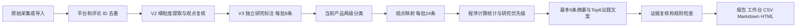

# 产品反馈决策洞察 V3

V3 将原始评论、细粒度观点、产品分类、程序统计和决策文案分开保存。目的在于帮助产品经理决定**先核查什么、还缺什么证据、如何验证**，不根据少量社交评论指定开发排期。

## 使用

启动方式仍为根目录 `start.cmd`，访问 <http://127.0.0.1:8765>。新任务默认 `analysis_version=2, insight_version=3`；已配置兼容模型时选择 AI 分析。真实采集和 JSON/JSONL/Excel 导入均沿用现有入口。

- 旧任务点击“升级决策报告”：复用已采集数据、初提取和复核观点，仅新增研究标注、分类及报告阶段。不会重复采集。
- 新报告默认“精简决策版”；“完整研究版”附全部两级分类、具体议题、质量记录和原文索引。
- 点击结论依据、维度图、痛点图、矩阵编号可查看关联评论，再打开原文抽屉。
- 抽屉支持逐观点修正意图、对象、立场、体验依据、严重性等，保留人工记录。修改后当前报告失效。
- “重新分析”更新分析；“仅重算统计”不调用模型，只复用仍有效的研究结果和依赖未变化的旧文案。修改后缺少有效研究标注的观点暂不支撑报告，而不是保留旧判断。
- Markdown 和打印 HTML 随当前精简/完整选项导出；CSV 始终包含全部去重评论，不仅是有效评论。浏览器打印 HTML 可另存为 PDF。

## 分析数据流



没有引入向量模型、向量数据库或任务队列。初始分类使用最多80个不同原始议题及原话，后续所有可用观点逐批映射。产品简介、实际观点和已有分类共同约束分类，不套用固定行业标签。

一级最多8类；初始每类1–4个二级类，总计最多32个。逐批映射优先复用已有类别，确有新问题可在已有一级下新增二级，全局最多40个；不能可靠映射的观点留在待归类记录。易用性、上手、新手和操作负担等高确定同义一级自动归并并保留 aliases；其他相似标签不冒充已完成语义判断，列入待复核。不同问题表现和未确定的根因仍保留在原始 `aspect/topic` 与观点中。

## 独立研究轴与纳入条件

| 轴 | 取值或意义 |
| --- | --- |
| `product_scope` | 目标产品 / 其他产品 / 待确认 |
| `intents` | 正面体验、负面体验、功能需求、使用疑问、故障反馈、改进建议、场景描述、事实说明、无关、无法判断；可多选 |
| `sentiment` | 正面、负面、中性、混合、未知；按观点分析，再聚合评论情绪 |
| `evaluation_object` | 产品、功能、教程、博主、平台内容、第三方、其他、待确认 |
| `stance` | 支持、反对、中立、不确定；不作为置信度 |
| `epistemic` | 实际体验、需求、疑问、资讯、猜测、未知 |
| `severity` | 未知、无后果、不便、耗时、任务阻断、数据丢失、安全风险 |
| `severity_quote / group_quote` | 明确后果 / 自述身份的连续原话；没有证据为空 |

有效反馈要求观点明确归属目标产品/功能，并有实质体验、需求、疑问、建议或场景意图。纯事实资讯、教程/博主/第三方评价、无法归属内容不直接进入产品反馈。疑似广告可人工恢复；人工排除优先。

满意点还要求 `epistemic=experience`、正面体验意图以及正面/混合情绪；痛点还要求实际体验、负面体验或故障意图及负面/混合情绪。因此“希望自动发送日报”可以是需求且带积极情绪，但不计满意；“教程没讲清楚”不直接计产品故障；“会不会丢文件”不等于已经丢失。

附和必须有可用父评论及逐字上下文引用；短评或没有产品名不是排除理由。相同议题出现相反体验时保留正负证据，标“体验分化，是否同场景待验证”，不推断双方描述的是相同版本或根因。

## 统计口径

| 名称 | 计算方式 / 分母 |
| --- | --- |
| 原始评论 | `raw_records` 中的评论记录数，重复导入也保留 |
| 去重评论 | 规范层记录数，按平台＋真实评论 ID 去重；缺 ID 分配本地证据编号并保留，不按同文去重 |
| 有效评论 | 存在可用产品观点、未人工排除且非疑似广告的唯一评论数 |
| 待确认 / 待处理 | 产品或对象、结构或研究标注不确定 / 尚未分析；与有效、排除互斥 |
| 排除评论 | 去重数减有效、待确认和待处理；原因单独汇总 |
| 观点 / 提及 | 一条评论可拆多个观点；议题提及数为其中的观点条数，不是独立事件数 |
| 维度 / 议题覆盖 | 唯一评论 ID 数；同评同维度只计一次；覆盖率分母为全部有效评论 |
| 维度负面占比 | 该维度内明确负面体验的唯一评论数 / 该维度覆盖评论数 |
| 总体情绪 | 有效评论内的观点情绪聚合，五类互斥；分母为有效评论数 |
| 意图分布 | 每种意图的唯一评论数 / 有效评论数；可多选、不能加总为100% |
| 可解析讨论串 | 沿真实父 ID 追溯至明确根评论；缺父关系、缺父评论、环路均记未知，不把每条评论当独立串 |
| 已知账户 | 平台内实际用户 ID 去重，附 ID 覆盖率；缺 ID 不补造，不跨平台合并真实人 |
| 附和 / 重复附和 / 补充 | 附和按评论数；同串同文附和额外记录重复提及；带明确场景或后果的直接回复另计补充 |

正负体验可以在一评、一维度交叉。评论、观点、账户、讨论串不可直接相加；已知账户和串是来源多样性线索，不能等同独立故障人数。各平台搜索排序、内容和回复可获取性不同，不将本次平台样本差异解释为整体口碑差异。

## 研究优先级与建议

优先级由 `decision_analysis.priority()` 确定，不允许模型填写精确分数。

| 等级 | 规则 |
| --- | --- |
| P0 | 直接实际体验中有数据丢失/安全风险及明确后果原话，需优先核查风险与复现条件；允许低频 |
| P1 | 有明确任务阻断原话；或有效样本覆盖至少10%、至少两个可解析串、两个已知账户、两条带场景/后果的直接体验 |
| P2 | 有直接问题体验，且有跨串或明确后果支持，适合常规验证 |
| P3 | 来源独立性、细节或频次不足；先补证据，低证据需求可以只给研究方向 |

严重性不是由负面词或点赞量推导；无明确引用则未知。业务价值和开发成本保留“未知”。矩阵横轴为可解析串、纵轴为明确后果线索，气泡大小表示评论覆盖；同坐标仅错开编号，不改数据位置。缺足够场景或自述角色组时不生成群体对比图。

每个重点议题包含问题、场景、具体表现、明确后果、用户明确期待、支持数量、研究假设、建议方向、验证方法与可观察指标。根因/深层需求允许为空。建议不填虚构目标值；用户原话是反馈，不等于已核实产品事实。

## 证据与质量约束

1. Pydantic 校验研究轴、分类、映射和报告 JSON；模型不输出统计值。研究标注按评论隔离失败项，其他阶段保留成功缓存。
2. 当前观点 quote 必须为当前原话连续子串；附和上下文必须来自未排除父评论。后果、场景、期待、自述角色字段同样校验原话来源。
3. 非体验不得计满意/已发生故障；严重性须有明确原话及保守语义规则。原始模型标注和每次保守修正均留存。
4. 程序按集合重算覆盖、分母与证据，未知 ID、无依据后果字段或计数不一致不发布报告。
5. 生成文案仅使用该议题的代表证据；证据支持复核、过度概括规则和重复文案检查不通过的表述移至附录待复核，不能支撑主文。
6. 精简版附齐所有引用的原话节选，包含分化观点的相反证据；完整版和 CSV 保留完整依据。导出校验同时检查 HTML 证据锚点。

程序检查和模型自检不能替代独立人工语义评估。初始提取漏掉的观点不会在升级时凭空恢复；应在工作台补充修正，或重新分析。

## 持久化、缓存和接口

`raw_records → comments.analysis → research_cache → effective → report/report_snapshots`。

`research_cache` 主键为任务、阶段键和输入 hash，保存研究初标、保守修正记录、分类、映射及文案；hash 包含原文/上下文、原始观点和提供商配置，不含密钥。人工覆盖与原始分析分离。来源变化使旧研究失效；排除父评论后不继续继承其观点。旧任务来源字段仅从已存原始记录回填，不推测账户或关系。

- `POST /api/tasks/{id}/report/upgrade`：复用观点升级。
- `POST /api/tasks/{id}/report/recount`：离线重算；仅保留引用及观点依赖未变化的文案。
- `GET /api/tasks/{id}/export/md?view=brief|full`、`export/html?view=brief|full`。
- `GET /api/schemas`：`research_v3`、`taxonomy_v3`、`taxonomy_mapping_v3`、`decision_narrative_v3`。

完整提示词在 `backend/insight/decision_analysis.py` 的 `RESEARCH/RESEARCH_PROTOCOL/TAXONOMY/MAP/SYNTHESIS`；结构定义在 `decision_schemas.py`，共享纳入规则在 `decision_state.py`。模型仅由后端调用，沿用现有取消、重启中断处理和单进程任务管理。

## 复现核查

```powershell
.\md\.venv\Scripts\python.exe -m pytest tests -q --disable-warnings
& 'C:\Program Files\nodejs\npm.cmd' --prefix frontend run build
node frontend/tests/decision-report-ui.mjs
.\md\.venv\Scripts\python.exe scripts/verify_decision_report.py 27587ab4-ab78-48af-8a42-7e8c41c04feb
.\md\.venv\Scripts\python.exe scripts/prepare_decision_evaluation.py 27587ab4-ab78-48af-8a42-7e8c41c04feb
```

后三项只读实际任务；导出及核查文件写在本机，不触发采集或模型。验收及已知限制见 [V3验收](DECISION_V3_ACCEPTANCE.md)，人工核查标准见 [评估方案](EVALUATION.md)。
